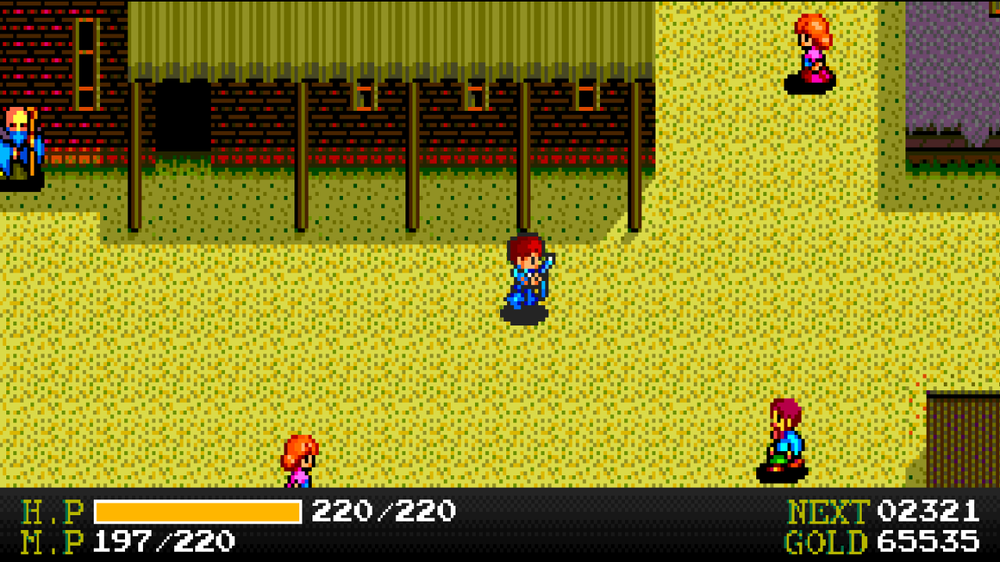
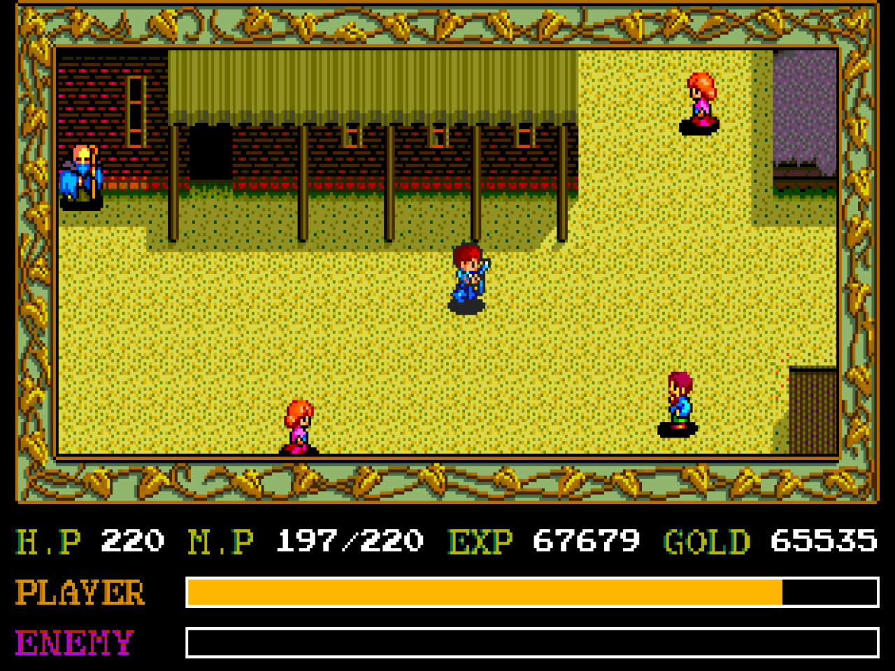
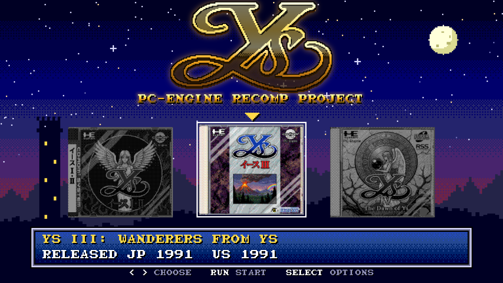
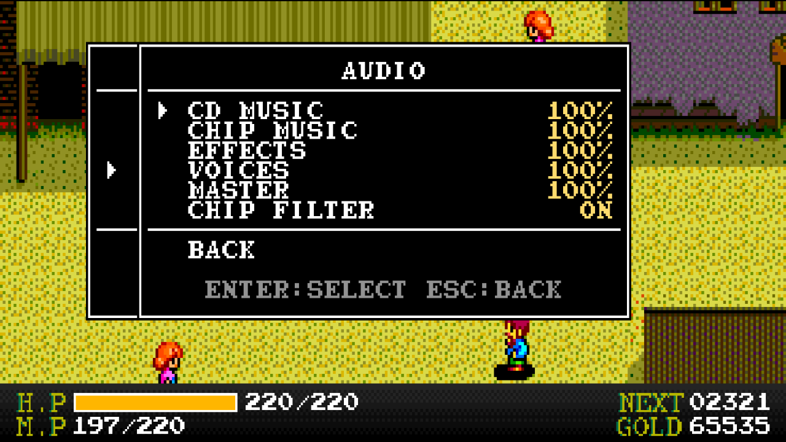
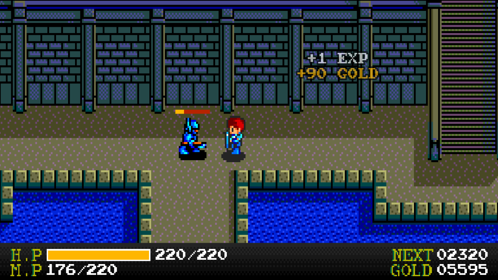
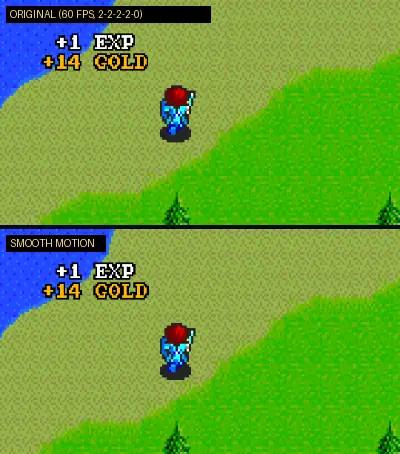

# YsRecomp

**Ys Book I & II (TurboGrafx-CD, 1989) running natively on Windows**, with a modern display, smooth motion above 60
FPS, a start menu, an options menu in the game's own style and a few quality-of-life extras. Point it at your own
bin/cue copy of the game and play: **no emulator and no System Card BIOS file needed.**



Project page: <https://GITHUB_USER.github.io/YsRecomp/>

The game's original machine code was translated to C ahead of time (*static recompilation*) with
[PCERecomp](https://github.com/GITHUB_USER/PCERecomp) and compiled together with a simulated PC Engine. Every
instruction behaves as on the console, and that is checked automatically against an interpreter and against the
Geargrafx emulator. The PC-side extras are drawn on top of the game without changing it.

> YsRecomp does not include the game. You need your own copy of *Ys Book I & II* (USA) as a BIN/CUE image.

| Original (the game's frame and panel) | Fill crop with the new status bar |
|---|---|
|  |  |
| **Launcher** | **Options menu in the game's font** |
|  |  |
| **Enemy HP bar and reward popup** | **Smooth motion (top: original rhythm, bottom: smooth; half speed)** |
|  |  |

## Features

**Start and menus**
- **Launcher** in the game's style: pixel starfield, the game's 8x8 font, the game's own sound effects, and the
  covers of the three PC Engine Ys games (Ys Book I & II is playable).
- **Options menu** (Esc or the controller's Menu button) drawn like the game's own SELECT menu, with the letters copied
  from your disc. The game pauses while it is open; CD and chip music keep playing.
- **No BIOS file**: the 43 System Card routines the game uses were rewritten in C and checked call by call against the
  real BIOS.
- **Portable**: settings (`YsRecomp.ini`), saves and everything else stay in the program's folder.

**Picture**
- **Crop border**: *Original* keeps the game's frame and status panel; *Full*, *Compact*, *Wide* and *Fill* remove the
  frame and show a new status bar under the map (H.P with its maximum, M.P in Ys II, NEXT, GOLD), the same in Ys I
  and Ys II. *Fill* fills a 16:9 screen; game windows (talk, shops, menus) are shown at 3/4 scale so they fit.
- **HUD background**: black or one of 14 dark gradients chosen to suit the gold HUD.
- **Smooth motion** (on by default): the game still runs at 60 steps per second, but the map and the characters are
  drawn between pixels at your monitor's refresh rate (120 Hz, 144 Hz, 180 Hz...), composed on the GPU, and the
  map scrolls at an even speed instead of the original 2-2-2-2-0 pixel rhythm.
- **Smooth fades**: the game's 7 brightness steps blend into each other.
- **CRT effect**: Scanlines, Lines+mask, Slot mask, Shadow mask, Glow, Glow+mask, Glow+slot, with Normal or Bright
  brightness; the mask size follows your screen.
- **Sharp or smooth filter**, **integer scale**, **pixel aspect** (TV 8:7, square, or stretch).
- The status bar and all menus get the same filter and CRT effect as the picture.
- **Fullscreen or window**, resolution, refresh rate, **V-Sync** on or off (for G-Sync/FreeSync), window size;
  screen mode changes revert by themselves if not confirmed.

**Game extras** (each can be turned off)
- **Visible equipment**: on the map, Adol wears the sword, shield and armor you have equipped, each with its own shape
  and colors (in the original he always looks the same), also in the reflection on the ice of Darm Tower.
- **Enemy HP bars**: a small bar over an enemy you hit, for 3 seconds.
- **Reward popups**: "+EXP" and "+GOLD" where an enemy dies, in large or small letters.
- **Instant dialog**: the few texts the game types out letter by letter appear whole at once.
- **Skip intro**: start straight at the title menu (skipping one scene at a time with Enter/A always works).
- **Pause in background** when the window loses focus.

**Sound and controls**
- Separate volumes for CD music, chip music, effects and voices, plus master.
- **Chip filter**: removes the harsh aliasing hiss of the sound chip on high notes (turn it off for the raw sound).
- **Controllers** (XInput and any controller Windows recognizes) and keyboard, with remappable buttons and two
  controller layouts.

## How to play

1. Download `YsRecomp.zip` from the [Releases](https://github.com/GITHUB_USER/YsRecomp/releases) page and unzip it
   anywhere (no installation; Windows 10 or 11, 64-bit).
2. Make a BIN/CUE image of **Ys Book I & II (USA)** from your own disc: one `.cue` and its `.bin` file(s) in one
   folder (for example the Redump set, 1 `.cue` + 43 tracks).
3. Run `YsRecomp.exe` and choose that folder when asked. The disc is checked; if a file is missing or it is a
   different version, a message says what is wrong.
4. In the launcher, press Run (Enter) to start and Select (Space) for options.

| | Keyboard | Controller |
|---|---|---|
| D-pad | Arrow keys | D-pad |
| Button I | X | A |
| Button II | Z | B |
| Select | Space | Y |
| Run | Enter | X |
| Options menu | Esc | Menu |
| Fullscreen | Alt+Enter | |

More in the player's readme ([package/README.txt](package/README.txt)), which ships in the zip.

## Building from source

Building needs files that cannot be distributed: the game's C code is generated on your machine **from your own
disc**, and the build also uses your own dump of the System Card 2.0 BIOS (only to build and test; the finished
program does not need it).

Requirements: Windows 10/11 64-bit, Visual Studio 2022 Build Tools (MSVC), Python 3.14. CMake comes with the Build
Tools and `build.ps1` finds it; SDL3 is downloaded by CMake on the first build.

```powershell
git clone --recursive https://github.com/GITHUB_USER/YsRecomp.git
cd YsRecomp
# put your files in roms\ (never committed):
#   roms\Ys Book I & II (USA).cue  (+ its .bin tracks)
#   roms\[BIOS] TurboGrafx CD System Card (USA) (v2.0).pce
.\build.ps1            # build (Release, in build\); the first build generates the game's C (~12 min)
.\build.ps1 -Test      # quick tests (~20 s)
.\build.ps1 -TestAll   # all tests
.\build.ps1 -Package   # player package in dist\YsRecomp\ and dist\YsRecomp.zip
```

PCERecomp is found in `external/PCERecomp` (the submodule) or in a sibling folder `..\PCERecomp`; `-DPCERECOMP_DIR=`
picks another one. Developer options (recording and replaying sessions, screen dumps, running with the real BIOS)
are described in [CLAUDE.md](CLAUDE.md) and [tools/trace/README.md](tools/trace/README.md).

## How it was made

- **Static recompilation.** The game loads its code from the CD into RAM in many pieces. Instead of collecting code
  from play sessions, the disc's file table and loader were worked out into a **disc map**
  ([games/ys/disc.toml](games/ys/disc.toml)), so the recompiler finds all of the disc's code at once. Each instruction
  becomes C that calls the same routine the interpreter uses; the rare code that is not found (about 0.001% of the
  instructions in long sessions) falls back to the interpreter.
- **Proved, not eyeballed.** The interpreter was checked instruction by instruction, frame by frame and sample by
  sample against the Geargrafx emulator; the recompiled code runs in **lockstep** against the interpreter (CPU state
  after every instruction, memory, image and sound every frame). The owner's recorded play sessions, including full
  playthroughs of Ys I and Ys II, are replayed through this chain as regression tests.
- **BIOS in C.** The System Card routines the game calls were rewritten in C and checked at every call in the recorded
  sessions against the real BIOS: same registers, memories, video state and order of hardware writes.
- **Read it from the game instead of guessing.** The enhancements first worked by looking at the output image; almost
  all of them were later rebuilt on hooks that read what the game itself is doing: its window system, raster
  interrupts, camera and actor tables, fade routines, status panel cells, reward routine and running disc program.
- **The PC layer does not change the game.** The extras are drawn around the simulated console, so the comparisons stay
  valid. The two exceptions (chip music while the options menu is open, and Instant dialog) are applied on both sides
  of the lockstep and noted in the recorded session.
- **Written by an AI.** All the code was written by an AI (Claude, by Anthropic), directed and play-tested by the
  author, who set the goals, played the game, recorded sessions, reported what he saw and approved each step. Every
  step ends with an automated test.

## Documentation

- [docs/devlog.md](docs/devlog.md): development log, findings and decisions
- [docs/technical_notes.md](docs/technical_notes.md): recompiler, CD, game files, PC-version internals
- [docs/ys_notes.md](docs/ys_notes.md): the game's memory, engine, windows, scrolling, fades, sound, disc layout
- [docs/ys_bios.md](docs/ys_bios.md): the BIOS routines the game uses
- [docs/ROADMAP.md](docs/ROADMAP.md): status and plans
- [PCERecomp](https://github.com/GITHUB_USER/PCERecomp): the recompiler and the simulated console

## Legal

- No ROM, disc image, BIOS or code generated from them is included in this repository or in the releases. The
  game's letters and sound effects used by the menus are read from your own disc at run time.
- Use YsRecomp only with a copy of the game you own.
- *Ys* is a trademark of Nihon Falcom Corporation. PC Engine, TurboGrafx-16 and TurboGrafx-CD are trademarks of their
  respective owners. This is an unofficial fan project, not affiliated with or endorsed by them.

## License

YsRecomp is released under the [MIT License](LICENSE). Third-party components (PCERecomp, SDL3, stb_image) and the
images are listed in [THIRD_PARTY_NOTICES.md](THIRD_PARTY_NOTICES.md).
